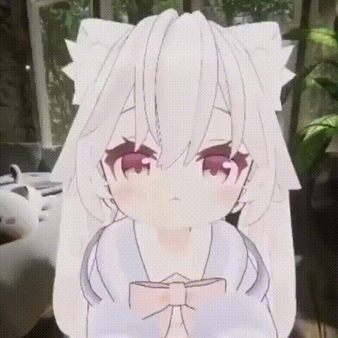
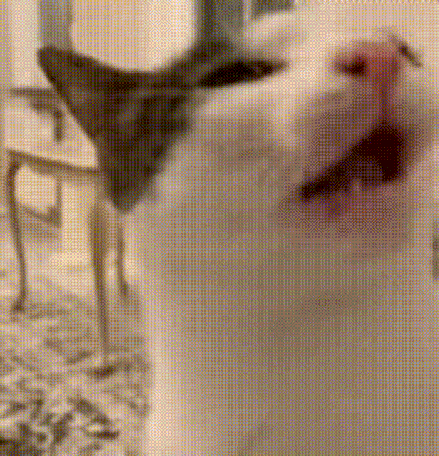
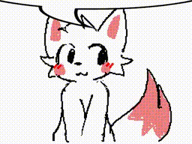
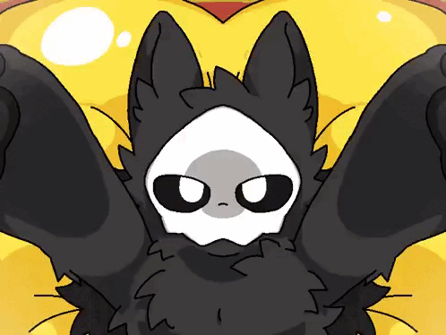
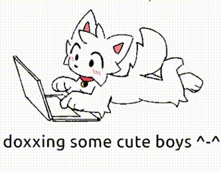
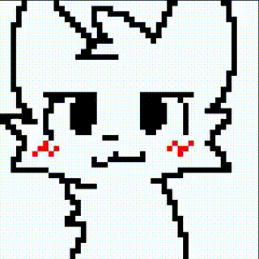
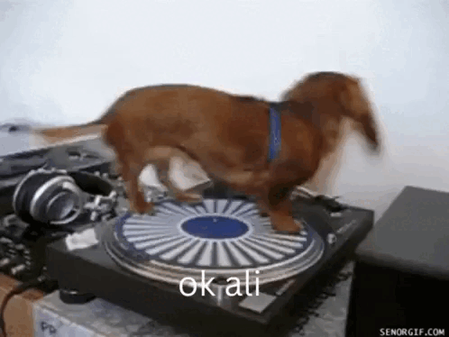

# Tutorial.. НААААААА.. ПЛАГИН!^⁠_⁠^
```by...
by yonari /WCG (WildCube Games) ヘ⁠（⁠。⁠□⁠°⁠）⁠ヘ
```


> Инструмент для распаковки игровых ресурсов ShiVa 3D и конвертации 3D-моделей `.msh` в `.glb`.

**Платформа:** Android  
**Терминал:** Termux  
**Язык:** Python 3  
**Зависимости:** стандартная библиотека Python

---

# ฅ⁠^⁠•⁠ﻌ⁠•⁠^⁠ฅ Содержание

1. [Установка приложений](#1-установка-приложений)
2. [Настройка Termux](#2-настройка-termux)
3. [Создание рабочей папки](#3-создание-рабочей-папки)
4. [Поиск OBB WildCraft](#4-поиск-obb-wildcraft)
5. [Извлечение S3DMain.smf](#5-извлечение-s3dmainsmf)
6. [Подготовка плагина](#6-подготовка-плагина)
7. [Распаковка SMF](#7-распаковка-smf)
8. [Поиск ресурсов](#8-поиск-ресурсов)
9. [Конвертация в GLB](#9-конвертация-в-glb)
10. [Решение проблем](#10-решение-проблем)

---

# 1. Установка приложений

Для работы понадобятся два приложения:

- **MT Manager** — файловый менеджер для работы с игровыми файлами и архивами.
- **Termux** — терминал Android, в котором запускаются скрипты Python.

### 1.1. MT Manager

Скачать: https://mt-manager.ru.uptodown.com/android

1. Откройте ссылку в браузере.
2. Скачайте APK-файл.
3. Откройте загруженный файл.
4. Разрешите установку из этого источника, если Android попросит.
5. Установите приложение.

### 1.2. Termux

Рекомендуемый источник: https://f-droid.org/packages/com.termux/

Установите приложение и откройте его.

---

# 2. Настройка Termux

### 2.1. Разрешение на доступ к файлам

Откройте Termux и введите:

```bash
termux-setup-storage
```

Android покажет запрос разрешения. Нажмите **«Разрешить»**.

### 2.2. Установка Python

Обновляем пакеты:

```bash
pkg update && pkg upgrade -y
```

Устанавливаем Python:

```bash
pkg install python -y
```

Проверяем установку:

```bash
python --version
```

Если появилась версия Python — всё готово.

---

# 3. Создание рабочей папки

Откройте MT Manager.

1. Перейдите во внутреннюю память телефона.
2. Найдите папку `storage`.
3. Откройте `emulated`.
4. Откройте папку `0`.

Полный путь:

```text
/storage/emulated/0/
```

Это корневая папка внутренней памяти телефона.

Здесь находятся папки `Download`, `DCIM`, `Android` и другие.

Создайте новую папку:

```text
MSH2GLB
```

В итоге получится:

```text
/storage/emulated/0/MSH2GLB/
```

---

# 4. Поиск OBB WildCraft

Нам понадобится OBB-файл игры.

OBB — это файл с дополнительными игровыми ресурсами. Его можно открыть как архив через MT Manager.

Откройте следующую директорию:

```text
/storage/emulated/0/Android/obb/
```

Найдите папку:

```text
com.turborocketgames.wildcraft
```

Откройте её.

Внутри должен находиться файл с расширением `.obb`.

Пример:

```text
main.XXXXXXXX.com.turborocketgames.wildcraft.obb
```

Нажмите на OBB-файл и выберите открытие как архива.

**Не нужно распаковывать весь OBB!**

---

# 5. Извлечение S3DMain.smf

В открытом архиве найдите файл:

```text
S3DMain.smf
```

Выделите его и выберите извлечение.

В качестве места назначения укажите:

```text
/storage/emulated/0/MSH2GLB/
```

После извлечения файл должен находиться здесь:

```text
MSH2GLB/S3DMain.smf
```

---

# 6. Подготовка плагина

Скопируйте два скрипта плагина в рабочую папку:

- `msh2glb.py`
- `smf_tool.py`

Итоговая структура:

```text
MSH2GLB/
├── S3DMain.smf
├── msh2glb.py
└── smf_tool.py
```

---

# 7. Распаковка SMF

Откройте Termux.

Переходим в рабочую папку:

```bash
cd "/sdcard/MSH2GLB/"
```

Теперь запускаем распаковку:

```bash
python smf_tool.py unpack S3DMain.smf game
```

После завершения появится папка:

```text
game/
```

В ней находятся распакованные игровые ресурсы.

---

# 8. Поиск ресурсов

Откройте через MT Manager:

```text
/sdcard/MSH2GLB/game/Resources/
```

Здесь находятся четыре основные директории:

| Папка | Назначение |
|---|---|
| `Meshes/` | 3D-модели |
| `Textures/` | Текстуры |
| `Skeletons/` | Скелеты |
| `AnimClips/` | Анимации |

Для примера будем извлекать лису из WildCraft.

Название модели:

```text
Fox_Big_Commom
```

### 8.1. Meshes

Путь:

```text
game/Resources/Meshes/
```

Найдите через поиск:

```text
Fox_Big_Commom
```

Переместите соответствующий `.msh` в основную папку `MSH2GLB`.

### 8.2. Textures

Путь:

```text
game/Resources/Textures/
```

# Tutorial.. НААААААА.. ПЛАГИН!^⁠_⁠^

```by...
by yonari /WCG (WildCube Games) ヘ⁠（⁠。⁠□⁠°⁠）⁠ヘ
```


> Инструмент для распаковки игровых ресурсов ShiVa 3D и конвертации 3D-моделей `.msh` в `.glb`.

**Платформы:** Android, Windows, Linux  
**Терминал:** Termux / CMD / PowerShell / Linux Terminal  
**Язык:** Python 3  
**Зависимости:** стандартная библиотека Python

---


# ฅ⁠^⁠•⁠ﻌ⁠•⁠^⁠ฅ Содержание

1. [Подготовка](#1-подготовка)
2. [Установка на Android](#2-установка-на-android)
3. [Установка на Windows](#3-установка-на-windows)
4. [Установка на Linux](#4-установка-на-linux)
5. [Извлечение S3DMain.smf](#5-извлечение-s3dmainsmf)
6. [Подготовка плагина](#6-подготовка-плагина)
7. [Распаковка SMF](#7-распаковка-smf)
8. [Поиск ресурсов](#8-поиск-ресурсов)
9. [Конвертация в GLB](#9-конвертация-в-glb)
10. [Решение проблем](#10-решение-проблем)

---


# 1. Подготовка

Для работы понадобятся:

- Python 3.
- Архиватор для открытия OBB.
- Скрипт `msh2glb.py`.
- Скрипт `smf_tool.py`.
- Файл `S3DMain.smf` из ресурсов игры.

### Ссылки на программы

- [Python — официальный сайт](https://www.python.org/downloads/)
- [Python для Windows](https://www.python.org/downloads/windows/)
- [MT Manager](https://mt-manager.ru.uptodown.com/android)
- [Termux — F-Droid](https://f-droid.org/packages/com.termux/)
- [7-Zip](https://www.7-zip.org/)

---


# 2. Установка на Android

### 2.1. Установка приложений

Установите следующие приложения:

- [MT Manager](https://mt-manager.ru.uptodown.com/android)
- [Termux с F-Droid](https://f-droid.org/packages/com.termux/)

Рекомендуется использовать версию Termux из F-Droid, а не устаревшую версию из Google Play.

### 2.2. Настройка Termux

Откройте Termux и выполните:

```bash
termux-setup-storage
```

Разрешите приложению доступ к файлам.

Обновите пакеты:

```bash
pkg update && pkg upgrade -y
```

Установите Python:

```bash
pkg install python -y
```

Проверьте установку:

```bash
python --version
```

### 2.3. Создание рабочей папки

Откройте MT Manager и перейдите в:

```text
storage/emulated/0/
```

Создайте папку:

```text
MSH2GLB
```

Полный путь:

```text
/storage/emulated/0/MSH2GLB/
```

---


# 3. Установка на Windows

### 3.1. Установка Python

Перейдите на официальный сайт:

[Скачать Python для Windows](https://www.python.org/downloads/windows/)

Скачайте установщик и запустите его.

**ВАЖНО:** при установке отметьте пункт:

```text
Add Python to PATH
```

После установки откройте CMD или PowerShell и проверьте:

```powershell
python --version
```

Если команда не работает, попробуйте:

```powershell
py --version
```

### 3.2. Установка архиватора

Скачайте и установите:

[7-Zip](https://www.7-zip.org/)

Он понадобится для извлечения `S3DMain.smf` из OBB-файла.

### 3.3. Создание рабочей папки

Создайте папку:

```text
C:\MSH2GLB\
```

В неё позже нужно будет поместить скрипты и игровые ресурсы.

---


# 4. Установка на Linux

### 4.1. Установка Python и архиватора

Для Ubuntu / Debian:

```bash
sudo apt update
sudo apt install python3 p7zip-full
```

Для Fedora:

```bash
sudo dnf install python3 p7zip
```

Для Arch Linux:

```bash
sudo pacman -S python p7zip
```

Проверьте установку:

```bash
python3 --version
```

### 4.2. Создание рабочей папки

Выполните:

```bash
mkdir -p ~/MSH2GLB
cd ~/MSH2GLB
```

Рабочая папка будет находиться по пути:

```text
/home/USER/MSH2GLB/
```

---


# 5. Извлечение S3DMain.smf

Для конвертации моделей понадобится файл `S3DMain.smf`, который находится внутри OBB-файла WildCraft.

## Android

Откройте MT Manager и перейдите в:

```text
/storage/emulated/0/Android/obb/com.turborocketgames.wildcraft/
```

Найдите OBB-файл с названием примерно такого вида:

```text
main.XXXXXXXX.com.turborocketgames.wildcraft.obb
```

Откройте его как архив.

Найдите файл:

```text
S3DMain.smf
```

Извлеките его в рабочую папку:

```text
/storage/emulated/0/MSH2GLB/
```

Если Android не позволяет открыть папку `Android/obb`, проверьте разрешения файлового менеджера.

## Windows

Скопируйте OBB-файл с телефона на компьютер.

Откройте его через 7-Zip.

Найдите:

```text
S3DMain.smf
```

Извлеките файл в:

```text
C:\MSH2GLB\
```

## Linux

Скопируйте OBB-файл на компьютер.

Перейдите в папку, где находится архив:

```bash
cd ~/Downloads
```

Посмотрите содержимое OBB:

```bash
7z l "main.XXXXXXXX.com.turborocketgames.wildcraft.obb"
```

Извлеките `S3DMain.smf` в рабочую папку:

```bash
7z e "main.XXXXXXXX.com.turborocketgames.wildcraft.obb" S3DMain.smf -o"$HOME/MSH2GLB"
```

---


# 6. Подготовка плагина

Поместите следующие файлы в рабочую папку:

```text
msh2glb.py
smf_tool.py
S3DMain.smf
```

Пример структуры папки на Android:

```text
MSH2GLB/
├── msh2glb.py
├── smf_tool.py
└── S3DMain.smf
```

На Windows:

```text
C:\MSH2GLB\
├── msh2glb.py
├── smf_tool.py
└── S3DMain.smf
```

На Linux:

```text
MSH2GLB/
├── msh2glb.py
├── smf_tool.py
└── S3DMain.smf
```

---


# 7. Распаковка SMF

Теперь необходимо распаковать игровые ресурсы.

## Android

Откройте Termux и выполните:

```bash
cd "/sdcard/MSH2GLB/"
```

Запустите распаковку:

```bash
python smf_tool.py unpack S3DMain.smf game
```

## Windows

Откройте CMD или PowerShell:

```powershell
cd "C:\MSH2GLB"
```

Запустите:

```powershell
python smf_tool.py unpack S3DMain.smf game
```

Если команда `python` не работает:

```powershell
py smf_tool.py unpack S3DMain.smf game
```

## Linux

Откройте терминал:

```bash
cd ~/MSH2GLB
```

Запустите:

```bash
python3 smf_tool.py unpack S3DMain.smf game
```

После успешного выполнения появится папка:

```text
game/
```

В ней будут находиться распакованные игровые ресурсы.

---


# 8. Поиск ресурсов

После распаковки откройте:

```text
game/Resources/
```

Внутри находятся различные игровые ресурсы.

Основные категории:

```text
Resources/
├── Meshes/
├── Textures/
├── Skeletons/
└── AnimClips/
```

### Meshes

В этой папке находятся 3D-модели с расширением `.msh`.

Например:

```text
Fox_Big_Commom.msh
```

### Textures

Здесь находятся текстуры моделей.

Для корректного отображения модели в GLB могут понадобиться соответствующие текстуры.

### Skeletons

В этой папке находятся скелеты моделей.

Они необходимы для моделей с костной анимацией.

### AnimClips

Здесь находятся игровые анимации.

Названия файлов анимаций не всегда совпадают с названием самой модели. Иногда они могут быть названы по имени персонажа.

**ВАЖНО:** у разных вариантов персонажей и редкостей могут отличаться ресурсы.

Для статических объектов скелет и анимации не требуются.

### Подготовка ресурсов

Найдите нужную модель в `Meshes/`.

Скопируйте её в рабочую папку вместе с соответствующими текстурами и другими необходимыми ресурсами.

---



# 9. Конвертация в GLB

Когда все необходимые файлы подготовлены, можно запускать конвертацию.

В качестве примера используем:

```text
Fox_Big_Commom.msh
```

## Android

Откройте Termux:

```bash
cd "/sdcard/MSH2GLB/"
```

Запустите:

```bash
python msh2glb.py Fox_Big_Commom.msh
```

## Windows

Откройте CMD или PowerShell:

```powershell
cd "C:\MSH2GLB"
```

Запустите:

```powershell
python msh2glb.py Fox_Big_Commom.msh
```

Если команда `python` не работает:

```powershell
py msh2glb.py Fox_Big_Commom.msh
```

## Linux

Откройте терминал:

```bash
cd ~/MSH2GLB
```

Запустите:

```bash
python3 msh2glb.py Fox_Big_Commom.msh
```

### Результат

После успешной конвертации должен появиться файл:

```text
Fox_Big_Commom.glb
```

Его можно открыть в любом совместимом просмотрщике GLB.

Например:

- Prisma3D.
- Blender.
- Онлайн-просмотрщики GLB.

**Важно:** вместо `Fox_Big_Commom.msh` указывайте название своей модели.

---



# 10. Решение проблем

### Python не найден

**Android:**

```bash
pkg install python -y
```

**Windows:**

Переустановите Python и убедитесь, что включён пункт `Add Python to PATH`.

Проверьте:

```powershell
py --version
```

**Linux:**

Для Ubuntu / Debian:

```bash
sudo apt install python3
```

### Termux не видит файлы

Выполните:

```bash
termux-setup-storage
```

После этого разрешите доступ к памяти устройства.

### Не найден S3DMain.smf

Проверьте:

- Правильно ли извлечён OBB.
- Находится ли `S3DMain.smf` в рабочей папке.
- Правильно ли указано имя файла.

### Не найдена модель

Убедитесь, что модель находится в распакованных ресурсах.

Проверьте папку:

```text
game/Resources/Meshes/
```

### Не отображаются текстуры

Проверьте, скопированы ли соответствующие текстуры в рабочую папку.

### Не работают анимации

Проверьте наличие необходимых скелетов и файлов анимаций.

### Команды для разных платформ

| Платформа | Команда Python |
|---|---|
| Android | `python` |
| Windows | `python` или `py` |
| Linux | `python3` |

---



# 👾 Готово! (⁠ ⁠◜⁠‿⁠◝⁠ ⁠)⁠♡

Теперь вы можете распаковывать игровые ресурсы ShiVa 3D и конвертировать модели `.msh` в `.glb` на Android, Windows и Linux.

**Plugin — WildCube (Yonari) Tools**


Найдите текстуры соответствующей модели и переместите их в `MSH2GLB`.

### 8.3. Skeletons

Путь:

```text
game/Resources/Skeletons/
```

Найдите скелет персонажа и переместите его в рабочую папку.

### 8.4. AnimClips

Путь:

```text
game/Resources/AnimClips/
```

Найдите анимации нужного персонажа.

**Важно:** названия анимаций могут отличаться от названия меша. Иногда они содержат только имя персонажа.

Учитывайте, что разные варианты персонажей, редкости и другие игровые вариации могут иметь разные ресурсы.

Если извлекается статичный объект без анимаций, искать скелет и AnimClips не требуется.

---

# 9. Конвертация в GLB

Возвращаемся в Termux.

Если вы находитесь не в рабочей папке, выполните:

```bash
cd "/sdcard/MSH2GLB/"
```

Запускаем конвертацию:

```bash
python msh2glb.py Fox_Big_Commom.msh
```

Вместо `Fox_Big_Commom.msh` укажите название своего Mesh-файла.

 убедитесь, что необходимые ресурсы перемещены в рабочую папку.

---

# 👾 Готово! (⁠ ⁠◜⁠‿⁠◝⁠ ⁠)⁠♡

Теперь вы можете извлекать игровые ресурсы ShiVa 3D и конвертировать модели в формат GLB.

**Plugin — WildCube (Yonari) Tools**


