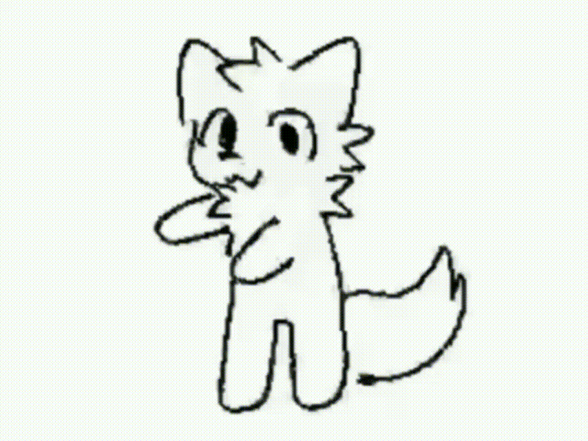
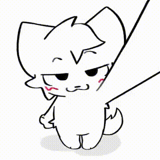
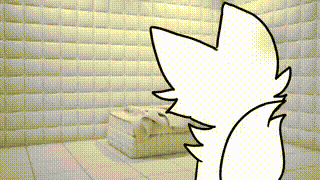

# Tutorial.. НААААААА.. ПЛАГИН!^⁠_⁠^
```by...
by yonari /WCG (WildCube Games) ヘ⁠（⁠。⁠□⁠°⁠）⁠ヘ
```


> Инструмент для распаковки игровых ресурсов ShiVa 3D и конвертации 3D-моделей `.msh` в `.glb`.

**Платформа:** Android  
**Терминал:** Termux  
**Язык:** Python 3  
**Зависимости:** стандартная библиотека Python

---

# ฅ⁠^⁠•⁠ﻌ⁠•⁠^⁠ฅ Содержание

1. [Установка приложений](#1-установка-приложений)
2. [Настройка Termux](#2-настройка-termux)
3. [Создание рабочей папки](#3-создание-рабочей-папки)
4. [Поиск OBB WildCraft](#4-поиск-obb-wildcraft)
5. [Извлечение S3DMain.smf](#5-извлечение-s3dmainsmf)
6. [Подготовка плагина](#6-подготовка-плагина)
7. [Распаковка SMF](#7-распаковка-smf)
8. [Поиск ресурсов](#8-поиск-ресурсов)
9. [Конвертация в GLB](#9-конвертация-в-glb)
10. [Решение проблем](#10-решение-проблем)

---

# 1. Установка приложений

Для работы понадобятся два приложения:

- **MT Manager** — файловый менеджер для работы с игровыми файлами и архивами.
- **Termux** — терминал Android, в котором запускаются скрипты Python.

### 1.1. MT Manager

Скачать: https://mt-manager.ru.uptodown.com/android

1. Откройте ссылку в браузере.
2. Скачайте APK-файл.
3. Откройте загруженный файл.
4. Разрешите установку из этого источника, если Android попросит.
5. Установите приложение.

### 1.2. Termux

Рекомендуемый источник: https://f-droid.org/packages/com.termux/

Установите приложение и откройте его.

---

# 2. Настройка Termux

### 2.1. Разрешение на доступ к файлам

Откройте Termux и введите:

```bash
termux-setup-storage
```

Android покажет запрос разрешения. Нажмите **«Разрешить»**.

### 2.2. Установка Python

Обновляем пакеты:

```bash
pkg update && pkg upgrade -y
```

Устанавливаем Python:

```bash
pkg install python -y
```

Проверяем установку:

```bash
python --version
```

Если появилась версия Python — всё готово.

---

# 3. Создание рабочей папки

Откройте MT Manager.

1. Перейдите во внутреннюю память телефона.
2. Найдите папку `storage`.
3. Откройте `emulated`.
4. Откройте папку `0`.

Полный путь:

```text
/storage/emulated/0/
```

Это корневая папка внутренней памяти телефона.

Здесь находятся папки `Download`, `DCIM`, `Android` и другие.

Создайте новую папку:

```text
MSH2GLB
```

В итоге получится:

```text
/storage/emulated/0/MSH2GLB/
```

---

# 4. Поиск OBB WildCraft

Нам понадобится OBB-файл игры.

OBB — это файл с дополнительными игровыми ресурсами. Его можно открыть как архив через MT Manager.

Откройте следующую директорию:

```text
/storage/emulated/0/Android/obb/
```

Найдите папку:

```text
com.turborocketgames.wildcraft
```

Откройте её.

Внутри должен находиться файл с расширением `.obb`.

Пример:

```text
main.XXXXXXXX.com.turborocketgames.wildcraft.obb
```

Нажмите на OBB-файл и выберите открытие как архива.

**Не нужно распаковывать весь OBB!**

---

# 5. Извлечение S3DMain.smf

В открытом архиве найдите файл:

```text
S3DMain.smf
```

Выделите его и выберите извлечение.

В качестве места назначения укажите:

```text
/storage/emulated/0/MSH2GLB/
```

После извлечения файл должен находиться здесь:

```text
MSH2GLB/S3DMain.smf
```

---

# 6. Подготовка плагина

Скопируйте два скрипта плагина в рабочую папку:

- `msh2glb.py`
- `smf_tool.py`

Итоговая структура:

```text
MSH2GLB/
├── S3DMain.smf
├── msh2glb.py
└── smf_tool.py
```

---

# 7. Распаковка SMF

Откройте Termux.

Переходим в рабочую папку:

```bash
cd "/sdcard/MSH2GLB/"
```

Теперь запускаем распаковку:

```bash
python smf_tool.py unpack S3DMain.smf game
```

После завершения появится папка:

```text
game/
```

В ней находятся распакованные игровые ресурсы.

---

# 8. Поиск ресурсов

Откройте через MT Manager:

```text
/sdcard/MSH2GLB/game/Resources/
```

Здесь находятся четыре основные директории:

| Папка | Назначение |
|---|---|
| `Meshes/` | 3D-модели |
| `Textures/` | Текстуры |
| `Skeletons/` | Скелеты |
| `AnimClips/` | Анимации |

Для примера будем извлекать лису из WildCraft.

Название модели:

```text
Fox_Big_Commom
```

### 8.1. Meshes

Путь:

```text
game/Resources/Meshes/
```

Найдите через поиск:

```text
Fox_Big_Commom
```

Переместите соответствующий `.msh` в основную папку `MSH2GLB`.

### 8.2. Textures

Путь:

```text
game/Resources/Textures/
```

Найдите текстуры соответствующей модели и переместите их в `MSH2GLB`.

### 8.3. Skeletons

Путь:

```text
game/Resources/Skeletons/
```

Найдите скелет персонажа и переместите его в рабочую папку.

### 8.4. AnimClips

Путь:

```text
game/Resources/AnimClips/
```

Найдите анимации нужного персонажа.

**Важно:** названия анимаций могут отличаться от названия меша. Иногда они содержат только имя персонажа.

Учитывайте, что разные варианты персонажей, редкости и другие игровые вариации могут иметь разные ресурсы.

Если извлекается статичный объект без анимаций, искать скелет и AnimClips не требуется.

---

# 9. Конвертация в GLB

Возвращаемся в Termux.

Если вы находитесь не в рабочей папке, выполните:

```bash
cd "/sdcard/MSH2GLB/"
```

Запускаем конвертацию:

```bash
python msh2glb.py Fox_Big_Commom.msh
```

Вместо `Fox_Big_Commom.msh` укажите название своего Mesh-файла.

Скрипт самостоятельно ищет связанные ресурсы в рабочей папке.

После успешной обработки должен появиться готовый файл `.glb`.

Его можно открыть в Prisma3D или другом GLB-просмотрщике.

---

# 10. Решение проблем

### Python не найден

```bash
pkg install python -y
```

### Termux не видит файлы

```bash
termux-setup-storage
```

### Не найден S3DMain.smf

Проверьте, что файл находится в папке `MSH2GLB`.

### Не найден Mesh

Проверьте название файла и его расположение.

### Не найдена текстура или скелет

Проверьте соответствующие директории и убедитесь, что необходимые ресурсы перемещены в рабочую папку.

---

# 👾 Готово! (⁠ ⁠◜⁠‿⁠◝⁠ ⁠)⁠♡

Теперь вы можете извлекать игровые ресурсы ShiVa 3D и конвертировать модели в формат GLB.

**Plugin — WildCube (Yonari) Tools**

